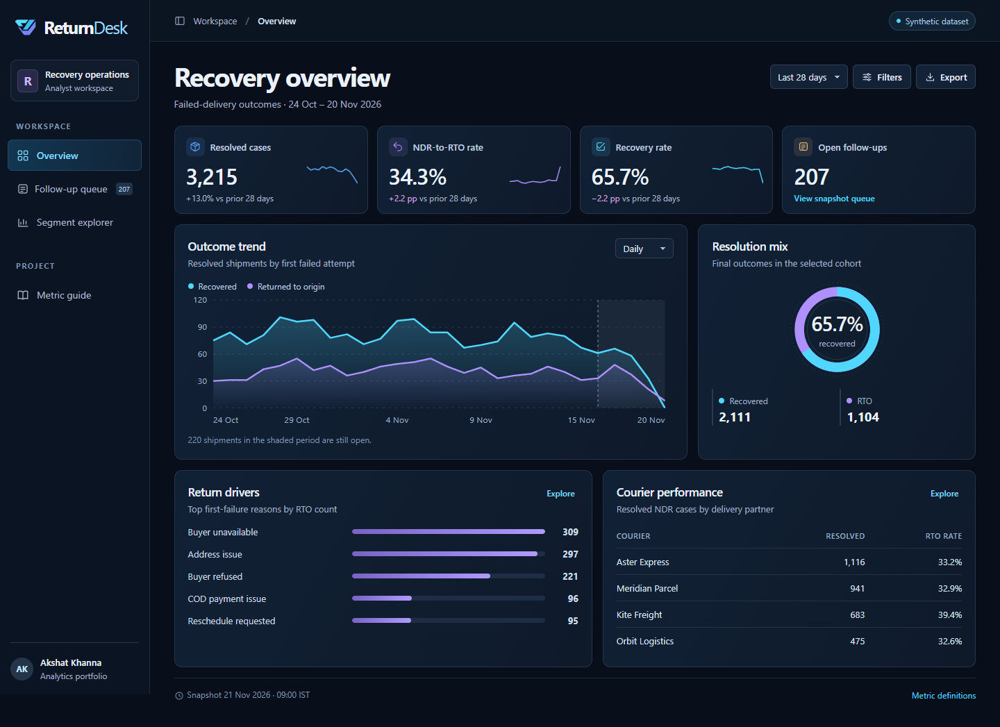

# ReturnDesk
[**Open the live dashboard**](https://khanna419.github.io/returndesk-rto-analytics/) · [**Download the Power BI report (.pbix)**](https://github.com/khanna419/returndesk-rto-analytics/raw/refs/heads/main/power-bi/ReturnDesk.pbix)

A failed-delivery analytics project for e-commerce operations. When a team can follow up on 50 shipments today, which cases should it work first and what should it do for each one?

## Open the dashboard

Extract the entire project folder and open **[index.html](index.html)** in a modern browser. The browser dashboard works offline without installation or sign-in. The shipment and courier records are simulated. The snapshot is fixed at **21 November 2026, 09:00 IST** so the numbers stay reproducible.

For the native report, open **[ReturnDesk.pbix](power-bi/ReturnDesk.pbix)** in Power BI Desktop. The file includes the populated data model and opens independently of the browser version. Its performance page starts with the full snapshot.



| View | What you can do |
| --- | --- |
| **Overview** | Compare resolved NDR cases, RTO rate and recovery rate. Choose a first-failure date range and filter by courier, payment, reason or destination. Inspect daily or weekly trends, outcome mix and return drivers. |
| **Segment explorer** | Rank failure reasons, couriers, merchants, states, PIN codes or payment types by return count, return rate or resolved volume. Set a minimum sample size before comparing rates. |
| **Follow-up queue** | Choose a capacity, narrow the eligible pool and open a shipment to see its attempt timeline, priority explanation and recommended action. Search and export the current worklist. |
| **Metric guide** | Check the denominator, time cutoff, ranking policy and proposed impact test. |

The overview opens on the most recent 28 full days. Choose **All dates** to reproduce the figures below. Historical filters use the date and reason of the first failed attempt. The follow-up queue uses the latest failed attempt and the fixed snapshot clock.

## Snapshot reconciliation

| Measure | All dates |
| --- | ---: |
| Delivery attempts | 19,535 |
| Shipments with a failed first attempt | 9,775 |
| Recovered deliveries | 6,388 |
| Confirmed RTO decisions | 3,167 |
| Open shipments | 220 |
| Actionable open shipments | 207 |
| Open buyer refusals held for review | 13 |

Among **9,555 resolved failed-delivery cases**, 33.1% resulted in RTO. This rate describes the simulated failed-delivery cohort. Measuring a merchant's overall RTO rate would require all shipments. Recent cohorts have had less time to resolve.

## What the analysis shows

Buyer refusal had the highest simulated RTO rate at **85.0%** (628 of 739). Buyer unavailability accounted for the greatest number of returns at **869**, despite a lower rate of **25.3%**. Those two findings support different decisions. A manager can investigate where the return volume originates, while an operator can prioritize a shipment where contacting the buyer could still change the outcome.

The queue ranks cases using failure age and repeat attempts, then recommends an action from the latest known reason. Its rules are transparent policy assumptions. The [interview walkthrough](INTERVIEW.md) explains how to test the policy against the current process at equal daily capacity.

## Reproduce the project

From the extracted ReturnDesk folder, run the following with Python 3.9 or later and its bundled SQLite library. The first command regenerates the sample from the fixed seed. The second derives the analytical tables, validates them, and updates the browser dashboard data.

```sh
python scripts/generate_data.py
python scripts/build_analytics.py
```

The [SQL folder](sql/README.md) also includes a MySQL 8 schema, loader, analytical views, and example queries. The portable workflow executes the analytical SQL in SQLite and provides the timestamp function used by the MySQL version.

## Project files

- [Data provenance and dictionary](data/DATA_CARD.md) documents source selection, the simulation design and its limitations.
- [Shipment records](data/shipments.csv) and [delivery attempts](data/attempts.csv) are the source tables. The manifest includes counts and hashes.
- [Resolved shipment export](data/analytics/history.csv) and [actionable cases export](data/analytics/queue.csv) link the SQL analysis to the dashboard.
- [Power BI project](power-bi/ReturnDesk.pbip) contains editable performance and worklist report pages.
- [Interview walkthrough and résumé bullets](INTERVIEW.md) includes a three-minute demo, two findings, a shipment-level example and a controlled pilot design.

This is an independent portfolio project inspired by the choices sellers face after a failed delivery attempt. Shiprocket documents the operational workflow. The estimated benefit of this project's prioritization policy remains a question for a real pilot. [Shiprocket NDR guide](https://support.shiprocket.in/support/solutions/articles/43000664209-what-is-ndr-)
